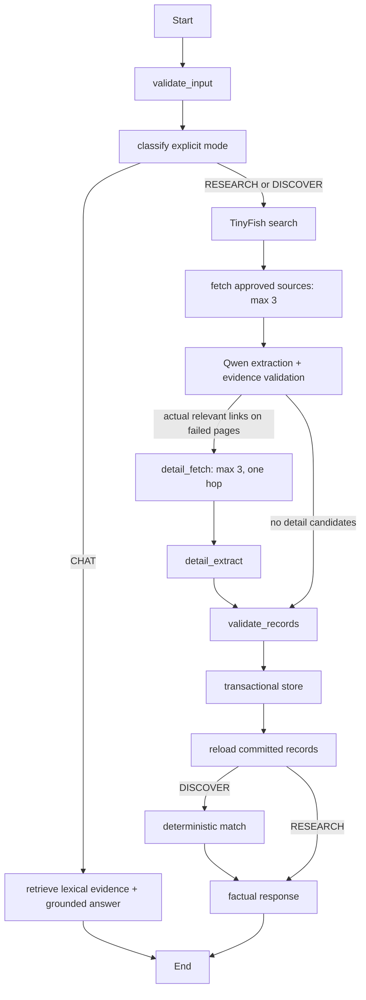

# One bounded LangGraph

`workflow.py` contains the single compiled graph; provider adapters are reusable
by both direct endpoints and graph nodes. Caller mode is explicit, not guessed
by an LLM. Profile validation and matching are deterministic.

Each graph node records a stage, SUCCESS/FAILED and nonnegative elapsed milliseconds,
correlated with an opaque workflow ID. Stage success means the node completed;
individual source failures are independently reported in `source_outcomes` and
`errors`. It does not imply every page succeeded or an eligibility guarantee.
Logs omit queries, profiles, URLs and page content. A failed overall request is
not recorded as a successful research run. A whole-request deadline bounds DB
preflight and graph execution to 360 seconds. Provider transports also have
bounds; there are no unbounded loops, automatic retry storms or recursive crawling.

Initial search leads are not confirmations. Fetching requires approved official
domains and safe URLs. Qwen schema output is checked against the actual fetched
page, quotes and supported numbers/facts, then revalidated before storage.
Prompt-injection text is treated as untrusted DATA. Completeness is conservative;
unsupported criteria/truncation leave coverage unknown. Evidence membership alone
cannot prove semantics, so manual official-source review remains necessary.

Store and retrieve are distinct. Database failures do not become successful saves;
DISCOVER matches only reloaded records. Some earlier records may already have
committed if a later save or timeout fails; the error tells users not to blindly
retry. Valid results survive independent fetch/extraction failures. A history-save
failure adds an explicit warning after valid research, without a fake history ID.

Eligibility precedence: failed mandatory → NOT_ELIGIBLE; otherwise unknown mandatory
(including source/coverage uncertainty) → NEEDS_INFORMATION; otherwise ELIGIBLE.
Optional failure/unknown does not disqualify. Exact case/whitespace normalization
is the only text equivalence. An expired recorded deadline is a mandatory failure.
Neither Qwen, lexical overlap nor future vector similarity may decide eligibility.

Assistant evidence selection is lexical over up to 30 stored records and passes
at most four records to Qwen. This is not semantic retrieval or embeddings.
Actual provider/DB/student-browser acceptance is still a separate unverified gate.
