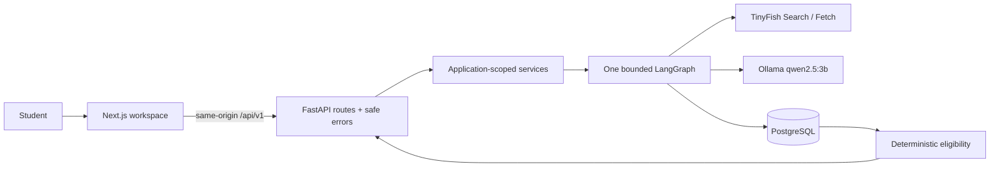

# SchemeRadar architecture

A modular monolith: Next.js provides the student workspace and proxies relative
API requests to FastAPI. One backend process owns a small PostgreSQL pool, a
TinyFish MCP client, a local Ollama client, and one compiled LangGraph. No paid
model, Redis, autonomous crawler, or vector eligibility decision is introduced.

## Actual responsibility map

| Path | Responsibility |
| --- | --- |
| `backend/app/main.py` | Bootstrap, lifecycle, CORS, body/concurrency limits, safe errors and request IDs |
| `backend/app/api/routes/operations.py` | Shared legacy/versioned HTTP handlers and response models |
| `backend/app/api/dependencies.py` | Resolve application-scoped dependencies; overrideable in tests |
| `backend/app/api/errors.py` | Typed compatible error envelope |
| `backend/app/services/runtime.py` | Construct the pool/providers/graph/semaphore once |
| `backend/app/services/research.py` | Workflow dispatch and opt-in history persistence policy |
| `backend/app/services/ollama.py` | Local Qwen requests, extraction evidence/schema checks and grounded answers |
| `backend/app/tools/tinyfish.py` | MCP Search/Fetch transport and response mapping |
| `backend/app/workflow.py` | Explicit graph, partial failures, safe stage diagnostics |
| `backend/app/models.py` | Authoritative Pydantic contracts shared by API/provider/store validation |
| `backend/app/eligibility.py` | Explicit normalization and rule-by-rule decisions |
| `backend/app/db.py` + `migrations/` | Parameterized SQL, transactions, stable identities and history |
| `backend/app/security.py` | Source-domain, URL and DNS guards |
| `frontend/src/lib/{api,contracts,types,scholarships}.ts` | Typed transport, runtime guards and reusable detail/history operations |
| `frontend/src/components/` | Shared workspace, profile-sensitive state, forms, results and history |
| `frontend/src/app/` | Dashboard, profile, discover, eligibility, assistant, research, about and scholarship details |

Logical boundaries are implemented without empty target-tree scaffolding or a
second schema/eligibility engine. JSONB remains the validated structured-rule
store; a new ORM or full relational rewrite would add migration risk without a
current query need. pgvector extension availability is not embedding retrieval.
Lexical assistant evidence selection is intentionally described as lexical.

## Verification boundary

Unit/API/component/HTTP tests verify local contracts and behavior. Real PostgreSQL,
TinyFish, Qwen and a browser-driven student journey require the configured services;
see `../DEVELOPMENT_STATUS.md`. This is not a claim of completed live acceptance.
