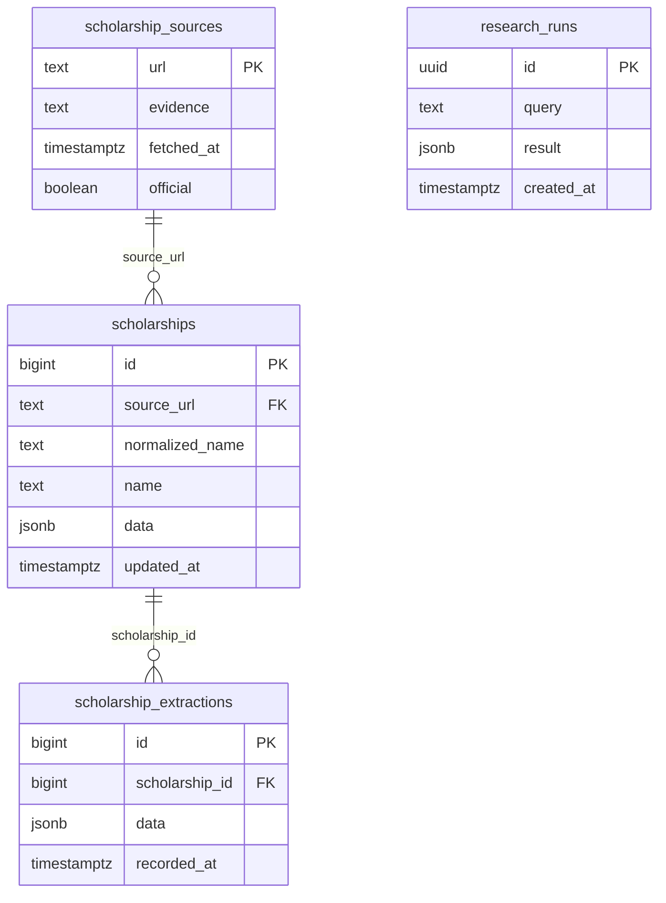

# Database design

PostgreSQL is the source of truth for scholarship evidence. No student profile
or deterministic match result is persisted. Pydantic validates JSONB on reads.

`(source_url, normalized_name)` is unique. Normalization is exact case folding
and collapsed whitespace, not inferred scheme equivalence. Different source URLs
are deliberately not merged on fuzzy names. Latest data includes six structured
criteria with mandatory flag, status, text values/numeric bounds, exclusive bounds
and quotations; scholarship facts, missing fields, coverage and provenance remain
part of the same validated snapshot. SQL-owned ID/timestamp are projected on reads,
not taken from an LLM or caller.

A save transaction upserts source evidence and the latest scholarship, then appends
an extraction snapshot selected by the same identity. A failure rolls all three
writes back. There is no delete cascade that silently removes audit history.
Snapshots start after migration; older history is not invented. Source evidence
is copied into snapshots so later updates do not erase earlier extraction context.

Research history is opt-in (`ENABLE_RESEARCH_HISTORY=false` by default), deployment-wide,
and accepts only RESEARCH results with empty matches, enforced in code and SQL.
It stores queries and public research evidence, not user accounts/profiles. Do not
include personal information in research queries. Operators must set a retention
policy and restrict access before enabling it in a public environment. Lists are
bounded; this is not automatic data expiry or a complete archival product.

## Migration and operations

From `backend`, with the existing configured environment: `python -m app.db`.
The runner applies idempotent 001 and additive 003 in a transaction/advisory lock;
002 is optional extension-only SQL and not semantic search. Before DDL, it refuses
an incompatible pre-existing flat scholarships table. Back up first. Do not attach
a PostgreSQL 16 data directory to PostgreSQL 17; no destructive conversion is supplied.

Indexes cover latest scholarships, JSONB rules, per-record snapshot order, and
research creation order. SQL is parameterized; IDs/limits are API-bounded.
Dedicated database tests verify repeat migrations/upserts/detail/snapshots when
`TEST_DATABASE_URL` is provided. They are skipped without it; SQL doubles do not
prove real constraints, rollback, restart persistence or compatibility with an
unknown Windows database. Actual PostgreSQL validation remains UNVERIFIED here.
